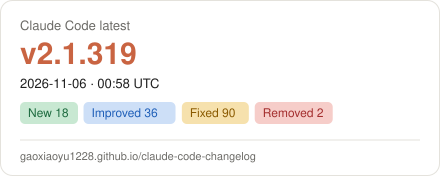

# Claude Code Changelog Calendar

Not a flat changelog: a release calendar built from Anthropic's official Claude Code CHANGELOG, so you can see what changed the way you'd naturally look at time — on a calendar. Synced once a day, in English and Chinese, with RSS, JSON and an embeddable card.

**Page:** https://gaoxiaoyu1228.github.io/claude-code-changelog-calendar/

> Source: Anthropic's official [CHANGELOG.md](https://github.com/anthropics/claude-code/blob/main/CHANGELOG.md) and npm release data, synced daily. Original text © Anthropic. Dates and times are UTC, based on npm publish time.
>
> Curated by @ Xiaoyu Gao · [gaoxiaoyu1228/claude-code-changelog-calendar](https://github.com/gaoxiaoyu1228/claude-code-changelog-calendar)

## Get updates

| Way | What you get | Address |
|---|---|---|
| RSS | One item per version, grouped by type with code, links and source links. Works in any reader or an RSS bot in Slack / Teams; pasting the site URL also works | [`feed.xml`](https://gaoxiaoyu1228.github.io/claude-code-changelog-calendar/feed.xml) · [`feed.zh.xml`](https://gaoxiaoyu1228.github.io/claude-code-changelog-calendar/feed.zh.xml) |
| Card | An image that always shows the latest version — summary or detailed | see below |
| Agents | A ready-to-paste prompt (on the page: Subscribe → For agents), plus JSON your agent can poll: a small index of the newest 30 versions and one file per version, so it only fetches what is new | [`releases/index.json`](https://gaoxiaoyu1228.github.io/claude-code-changelog-calendar/releases/index.json) · [`llms.txt`](https://gaoxiaoyu1228.github.io/claude-code-changelog-calendar/llms.txt) (guide for agents) · [`latest.json`](https://gaoxiaoyu1228.github.io/claude-code-changelog-calendar/latest.json) (last 7 release days) |
| Webhook | A message in your own Slack / Discord / Feishu / WeCom / DingTalk group | copy [`templates/notify-webhook.yml`](templates/notify-webhook.yml) into your repo |
| Full data | Every entry since 2025-03 | [`data/all.json`](https://gaoxiaoyu1228.github.io/claude-code-changelog-calendar/data/all.json) · [`changelog.csv`](https://gaoxiaoyu1228.github.io/claude-code-changelog-calendar/changelog.csv) |

## Latest version card

Two versions, both refreshed daily. Add `.zh` before `.svg` for Chinese (`latest.zh.svg`, `latest-detail.zh.svg`).

| Version | Shows | Good for | Image |
|---|---|---|---|
| Summary (default) | Version, publish time (UTC), count per type | README, profile page, docs sidebar | `latest.svg` |
| Detailed | The above + every entry, grouped by type | Weekly notes, team wiki, chat shares | `latest-detail.svg` |

```markdown
[](https://gaoxiaoyu1228.github.io/claude-code-changelog-calendar/)
```



How to use it (any tool):

1. **Keeps itself current:** paste the Markdown above anywhere that renders Markdown (README, Notion, blog, wiki).
2. **No Markdown?** Use the image URL with your editor's "insert image from link".
3. Some platforms cache images, so a new version can show up a few hours late.
4. **For chat, email or slides:** open the page → Subscribe → Latest version card → Download image (PNG). A downloaded image does not update.

## Data format

`releases/index.json` — the newest 30 versions, no entries. Compare with the last version you saw, then read each newer `json` URL.

```json
{
  "generated": "2026-11-08T07:17:00Z",
  "latest": "2.1.319",
  "releases": [ { "version": "2.1.319", "date": "2026-11-06", "published": "…", "url": "…#v2.1.319", "counts": { … }, "json": "…/releases/2.1.319.json" } ]
}
```

`releases/2.1.319.json` — one version with every entry; same shape as an item in `latest.json` `releases[]`. Field names are stable: new fields may be added, existing ones are not renamed or removed. Full guide: [`llms.txt`](https://gaoxiaoyu1228.github.io/claude-code-changelog-calendar/llms.txt).

`latest.json`

```json
{
  "generated": "2026-11-07T10:00:00Z",
  "latest": { "version": "2.1.319", "date": "2026-11-06", "published": "…", "url": "…#v2.1.319", "counts": { "new": 18, "fixed": 90 } },
  "releases": [ { "version": "2.1.319", "counts": { … }, "entries": [ { "type": "new", "en": "…", "zh": "…" } ] } ]
}
```

`type` is one of `new`, `improved`, `fixed`, `removed`, `other`.

## Links to a version

Every version has a stable link: `…/claude-code-changelog-calendar/#v2.1.319`.

---

## 中文说明

**Claude Code 更新日历**：不是一份平铺的更新日志，而是基于 Anthropic 官方 CHANGELOG 做的「更新日历」，用最自然的方式（看日历）了解 Claude Code 的变化。每天同步一次。日期和时间均为 UTC（国际标准时间）。网页默认英文，右上角可切换中文；其他语言请用浏览器自带的翻译。

| 方式 | 效果 | 地址 |
|---|---|---|
| RSS | 每个版本一篇，按类型分小标题，保留代码和链接格式，附来源链接；放进阅读器或 Slack、飞书的 RSS 机器人；直接贴网址也能自动找到 | `feed.zh.xml`（中文）/ `feed.xml`（英文） |
| 最新版本卡片 | 概要版（版本号、时间、各类条数）/ 明细版（再加全部条目，按类型分组），每天自动变成最新版本；网页「订阅」里可复制代码或下载 PNG | 概要 `latest.zh.svg` · 明细 `latest-detail.zh.svg` |
| 给 Agent 用 | 网页「订阅 → 给 Agent 用」可复制一段指令直接贴给 Agent；数据按版本拆分（最近 30 个版本的目录 + 每个版本一个文件），Agent 只取比上次新的 | `releases/index.json`；`llms.txt` 是写给 Agent 的说明书；`latest.json` 是最近 7 个发布日 |
| Webhook | 推到你自己的群机器人 | 把 `templates/notify-webhook.yml` 复制到你自己的仓库，填上地址；地址只存在你那里 |

内容来自 Anthropic 官方 CHANGELOG.md 与 npm 发布记录，每日自动同步；原文版权归 Anthropic。

整理：@ Xiaoyu Gao · [gaoxiaoyu1228/claude-code-changelog-calendar](https://github.com/gaoxiaoyu1228/claude-code-changelog-calendar)
